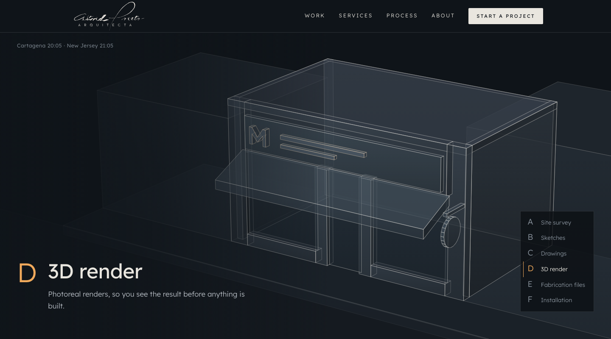
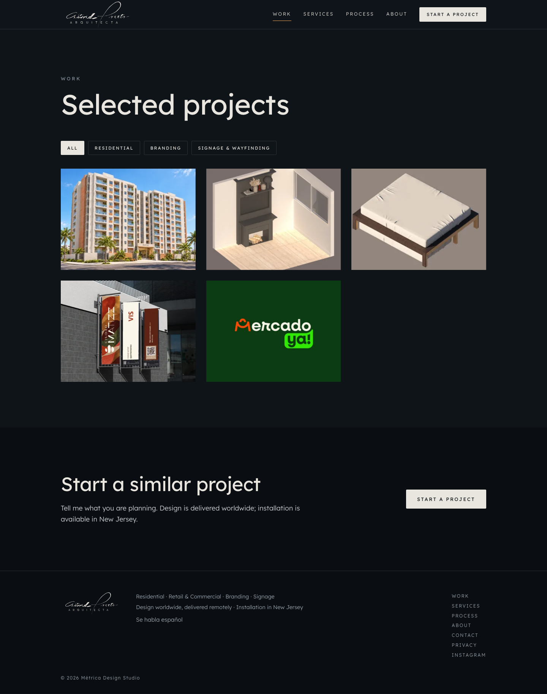
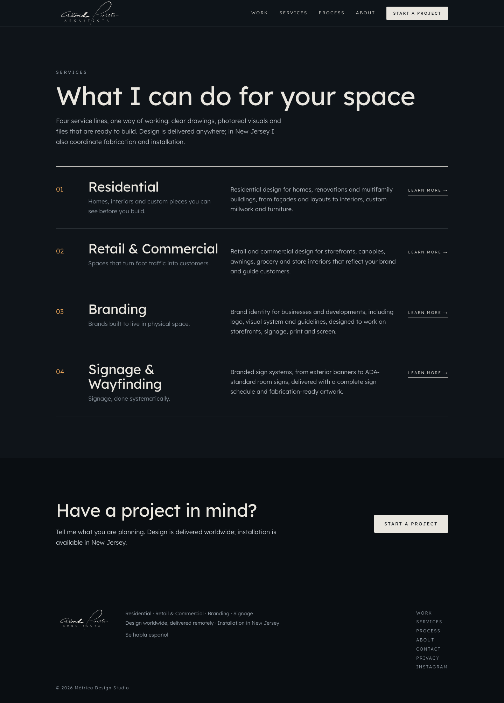
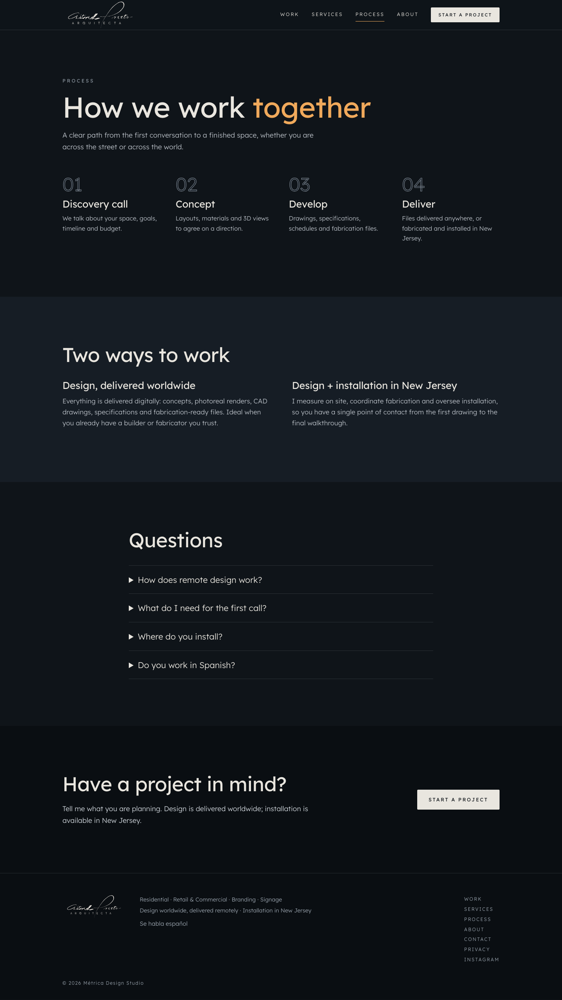
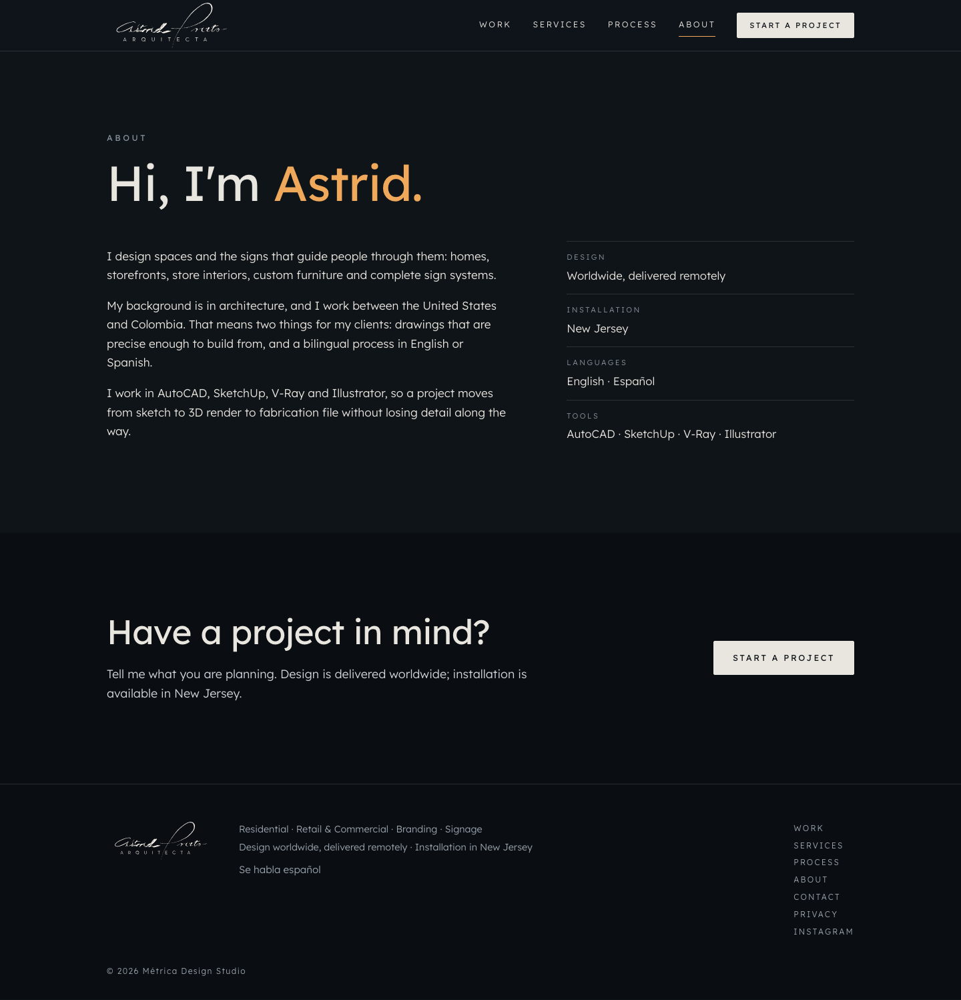
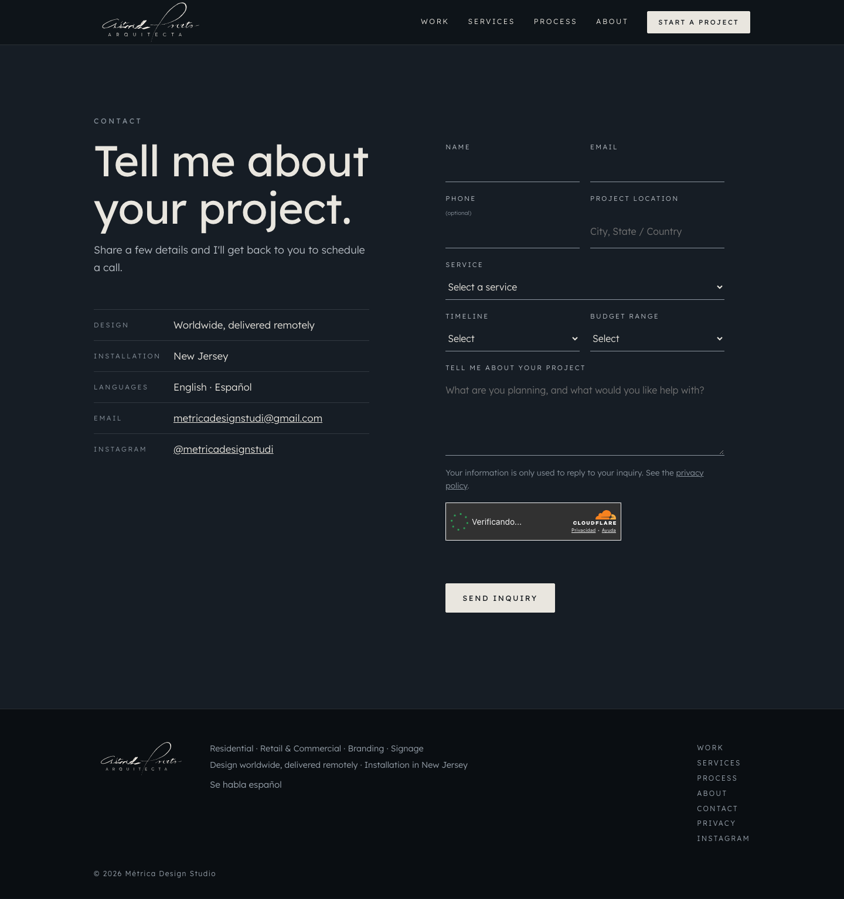
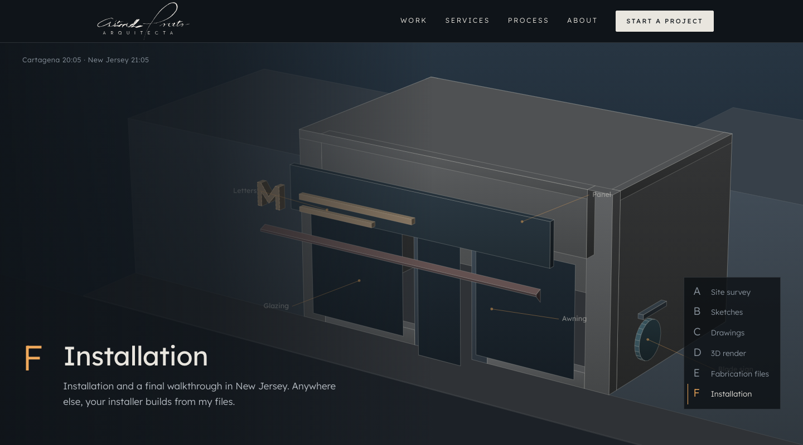
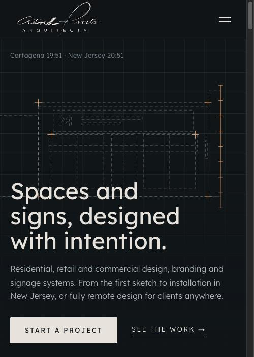

# Métrica Design Studio — sitio web / website

🇪🇸 [Español](#español) · 🇬🇧 [English](#english)

---

## Español

Sitio web de un estudio de diseño de espacios y señalización (residencial, comercial, branding y rotulación) con base en New Jersey y entrega remota a todo el mundo. Lo desarrollé para una arquitecta, con su aprobación. Fui asistido por IA.

🔗 En línea: https://metricadesignstudio.com

> Este repositorio contiene solo capturas y la descripción técnica.

### Qué hace
- Portada con una escena animada en canvas que recorre las 6 etapas de un trabajo: visita y medidas, bocetos, planos, render 3D, archivos de fabricación e instalación.
- Páginas de trabajos (con filtros por categoría), servicios, proceso, acerca de, privacidad y contacto.
- Formulario de contacto con validación en el servidor, antibots y límite de envíos.
- Sitio bilingüe en intención (inglés principal, atención en español).

### Lenguajes y herramientas
| Área | Tecnología |
|---|---|
| Lenguajes | TypeScript, HTML, CSS, Markdown |
| Framework | Astro 7 (sitio estático, `@astrojs/sitemap`) |
| Animación | GSAP + ScrollTrigger, Lenis (scroll suave), canvas 2D con motor propio |
| Tipografía | Lexend (licencia OFL, autoalojada) |
| Backend | Cloudflare Worker en TypeScript (`/api/contact`) |
| Seguridad | Cloudflare Turnstile, límite de 3 envíos por minuto, validación del lado servidor, secretos fuera del repositorio |
| Correo | Resend |
| Infraestructura | Cloudflare Workers + dominio propio con HTTPS, despliegue desde GitHub |
| Entorno | Node.js 22, npm, Wrangler |

### Capturas
Páginas completas, de arriba a abajo:

**Trabajos**

**Servicios**

**Proceso**

**Acerca de**

**Contacto**

**Portada, etapa F (instalación)**

**Móvil**

### Qué aprendí / practiqué
Despliegue en la nube con dominio y HTTPS, manejo de secretos, protección de formularios contra spam, y trabajo con IA como herramienta de desarrollo (especificar, revisar y verificar en producción).

---

## English

Website for a space and signage design studio (residential, retail/commercial, branding and signage) based in New Jersey, delivering remotely worldwide. I built it for an architect, with her approval. I was assisted by AI.

🔗 Live: https://metricadesignstudio.com

> This repository only holds screenshots and the technical write-up.

### What it does
- Home page with an animated canvas scene that walks through the 6 stages of a job: site survey, sketches, drawings, 3D render, fabrication files and installation.
- Work (with category filters), services, process, about, privacy and contact pages.
- Contact form with server-side validation, bot protection and rate limiting.
- Bilingual in intent (English first, Spanish support).

### Languages and tools
| Area | Technology |
|---|---|
| Languages | TypeScript, HTML, CSS, Markdown |
| Framework | Astro 7 (static site, `@astrojs/sitemap`) |
| Motion | GSAP + ScrollTrigger, Lenis (smooth scroll), custom 2D canvas engine |
| Typography | Lexend (OFL license, self-hosted) |
| Backend | Cloudflare Worker in TypeScript (`/api/contact`) |
| Security | Cloudflare Turnstile, 3 submissions per minute rate limit, server-side validation, secrets kept out of the repository |
| Email | Resend |
| Infrastructure | Cloudflare Workers + custom domain with HTTPS, deployed from GitHub |
| Environment | Node.js 22, npm, Wrangler |

### Screenshots
Full pages, top to bottom:

**Work**

**Services**

**Process**

**About**

**Contact**

**Home, stage F (installation)**

**Mobile**

### What I learned / practiced
Cloud deployment with a custom domain and HTTPS, secrets management, protecting forms against spam, and working with AI as a development tool (specifying, reviewing and verifying in production).
